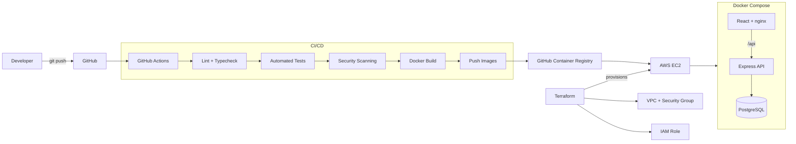

# CI/CD Platform Demo

A production-style full-stack application demonstrating a complete DevOps lifecycle from code commit to cloud deployment.

**GitHub Actions · Docker · Terraform · AWS · PostgreSQL · TypeScript**

[](https://github.com/OWNER/cicd-platform-demo/actions/workflows/ci-cd.yml)


> Replace `OWNER` with your GitHub username or organization before publishing.

## Overview

This project uses a simple **Service Status Dashboard** as the application layer while focusing on the engineering and infrastructure around it.

The application provides a REST API and React frontend for managing the status of internal services.

The main goal is to demonstrate a realistic development and deployment workflow:

```text
Code
  ↓
GitHub
  ↓
GitHub Actions
  ↓
Test + Security Scan
  ↓
Docker Build
  ↓
GitHub Container Registry
  ↓
AWS EC2
  ↓
Docker Compose
```

## What This Demonstrates

* CI/CD with GitHub Actions
* TypeScript full-stack development
* Docker multi-stage builds
* Docker Compose
* Automated unit, integration and component testing
* Container and dependency security scanning
* Secret scanning
* Infrastructure as Code with Terraform
* AWS EC2 and VPC networking
* Immutable commit-SHA Docker releases
* Automated deployment
* Application health and readiness checks
* Structured logging
* Environment-based configuration
* Deployment rollback

## Architecture



Terraform provisions the AWS infrastructure, while GitHub Actions handles application delivery. This keeps infrastructure management and application deployment as separate concerns.

## Tech Stack

| Area           | Technology                                     |
| -------------- | ---------------------------------------------- |
| Backend        | Node.js, TypeScript, Express                   |
| Database       | PostgreSQL                                     |
| ORM            | Prisma                                         |
| Validation     | Zod                                            |
| Logging        | Pino                                           |
| Frontend       | React, TypeScript, Vite                        |
| Testing        | Vitest, Supertest, React Testing Library       |
| Containers     | Docker, Docker Compose                         |
| CI/CD          | GitHub Actions                                 |
| Security       | Trivy, Gitleaks, npm audit, Dependabot, Helmet |
| Infrastructure | Terraform                                      |
| Cloud          | AWS EC2, VPC, IAM                              |
| Registry       | GitHub Container Registry                      |

## Repository Structure

```text
cicd-platform-demo/
├── backend/                  # Express + TypeScript + Prisma API
├── frontend/                 # React + TypeScript application
├── docker/                   # nginx, entrypoint and health-check assets
├── infrastructure/
│   └── terraform/            # AWS infrastructure
├── .github/
│   ├── workflows/
│   │   └── ci-cd.yml         # CI/CD pipeline
│   ├── dependabot.yml
│   └── PULL_REQUEST_TEMPLATE.md
├── docs/
│   └── deployment.md         # Deployment runbook
├── docker-compose.yml        # Local development
├── docker-compose.prod.yml   # Production deployment
├── .env.example
├── LICENSE
└── README.md
```

## Quick Start

### Requirements

* Node.js 20+
* npm
* Docker
* Docker Compose

### Run the complete stack

```bash
cp .env.example .env
docker compose up --build
```

The application will then be available at:

* Frontend: `http://localhost:8080`
* Backend API: `http://localhost:4000/api`
* PostgreSQL: `localhost:5432`

The database port is exposed for local development only and is not exposed in the production configuration.

### Seed example data

```bash
cd backend
npm run prisma:seed
```

## Testing

Backend tests include unit and integration tests against PostgreSQL.

Frontend tests cover the main React components and application states.

Run the backend tests:

```bash
cd backend
npm test
npm run test:coverage
```

Run the frontend tests:

```bash
cd frontend
npm test
```

All tests are enforced as part of the CI pipeline.

## CI/CD Pipeline

The GitHub Actions workflow runs on pull requests and pushes to `main`.

```text
Pull Request / Push
        │
        ▼
┌───────────────────┐
│ Lint + Typecheck  │
└─────────┬─────────┘
          ▼
┌───────────────────┐
│ Automated Tests   │
└─────────┬─────────┘
          ▼
┌───────────────────┐
│ Dependency +      │
│ Secret Scanning   │
│ npm audit         │
│ Gitleaks          │
└─────────┬─────────┘
          ▼
┌───────────────────┐
│ Docker Build      │
│ + Trivy Scan      │
└─────────┬─────────┘
          ▼
┌───────────────────┐
│ Push to GHCR      │
└─────────┬─────────┘
          ▼
┌───────────────────┐
│ Deploy to EC2     │
└───────────────────┘
```

Image pushing and deployment are restricted to successful pushes to `main`.

Pull requests run the quality and security gates but cannot deploy to production.

### Immutable Releases

Docker images are tagged using the Git commit SHA:

```text
ghcr.io/<owner>/cicd-platform-demo-backend:<commit-sha>
ghcr.io/<owner>/cicd-platform-demo-frontend:<commit-sha>
```

The deployment process uses the SHA tag rather than relying on `latest`.

This creates a traceable relationship between:

```text
Git Commit → CI Pipeline → Docker Image → Production
```

The exact application version deployed to the server can therefore be identified and rolled back.

## Security

Security checks are integrated directly into the CI/CD pipeline.

### Dependency and Container Scanning

* `npm audit` checks application dependencies.
* Dependabot provides automated dependency updates.
* Trivy scans Docker images for HIGH and CRITICAL vulnerabilities.

### Secret Detection

Gitleaks scans the repository for accidentally committed credentials and secrets.

No application secrets or AWS credentials are stored in the repository.

### Container Security

The application containers:

* Run as non-root users
* Use multi-stage builds
* Use environment-based configuration
* Include health checks

### Application Security

The API uses:

* Helmet security headers
* Rate limiting
* Zod request validation
* Structured logging

### AWS Security

The infrastructure includes:

* Restricted SSH access
* Security groups
* IMDSv2
* IAM roles
* No publicly exposed PostgreSQL port

PostgreSQL is accessible only through the internal Docker network.

## Infrastructure

Terraform provisions a small AWS environment consisting of:

* VPC
* Public subnet
* Internet Gateway
* Route table
* Security group
* IAM role
* EC2 instance
* Elastic IP

Terraform configuration is located in:

```text
infrastructure/terraform/
```

Initialize and validate the configuration with:

```bash
cd infrastructure/terraform

terraform init
terraform fmt
terraform validate
terraform plan
```

Infrastructure deployment details are documented separately in:

[`docs/deployment.md`](docs/deployment.md)

## Deployment

The production environment runs the application using Docker Compose on an AWS EC2 instance.

The deployment workflow:

1. Builds the application
2. Runs tests and security checks
3. Builds Docker images
4. Tags images with the commit SHA
5. Pushes images to GHCR
6. Connects to EC2 over SSH
7. Pulls the exact SHA-tagged images
8. Starts the new application version

The deployment host pulls the public GHCR images without storing registry credentials.

Detailed setup, required GitHub Secrets and rollback procedures are documented in:

[`docs/deployment.md`](docs/deployment.md)

## Health & Observability

The backend exposes:

```text
GET /api/health
GET /api/ready
GET /api/metrics
```

Health checks are used by Docker to determine whether containers are functioning correctly.

The backend also provides structured logging through Pino.

A full Prometheus/Grafana observability stack is intentionally outside the scope of this project and is listed as a future improvement.

## Engineering Decisions

### SHA-based Docker releases

Using commit SHA tags makes deployments immutable and traceable instead of relying on a mutable `latest` tag.

### Multi-stage Docker builds

Build dependencies are kept out of the final production images, reducing image size and unnecessary attack surface.

### Separation of Terraform and CI/CD

Terraform manages infrastructure while GitHub Actions manages application deployment. This prevents the application pipeline from unnecessarily modifying cloud infrastructure.

### No GHCR credentials on EC2

The images are public because they are built entirely from the public repository. This allows the EC2 host to pull images anonymously without storing a persistent registry credential.

## Future Improvements

Possible extensions include:

* Application Load Balancer
* HTTPS with AWS Certificate Manager
* Multi-AZ deployment
* Private application subnets
* Amazon RDS for PostgreSQL
* Remote Terraform state
* Blue/green deployments
* Canary deployments
* Prometheus and Grafana
* Centralized logging
* Authentication and authorization
* Kubernetes deployment

## Project Scope

The project intentionally uses a single EC2 instance and Docker Compose to keep the infrastructure understandable and affordable for a portfolio environment.

The architecture is designed so that it can later be extended toward a more production-grade cloud deployment.

## License

This project is licensed under the MIT License.

